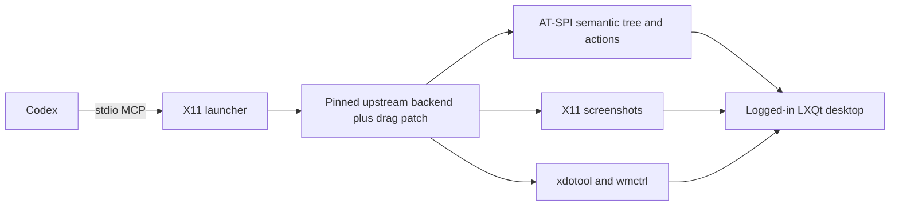

# Architecture

Codex starts the connector as a stdio Model Context Protocol (MCP) server. The launcher connects the process to your existing Linux desktop session.

## Build boundary

The installer fetches upstream commit `3bb80c77be8e5fee5f871c2443ffed2c5156b5d1`, applies the checked-in patch, and builds with `cargo build --release --locked`. The lockfile pins upstream's Rust dependencies. The original Ubuntu 22.04 build used Rust 1.99.1 and GLIBC 2.35.

Only the main `computer-use-linux` binary is built. The COSMIC helper and Wayland indicator are outside this X11 setup's scope. Source builds run upstream's MCP contract check before installation.

A reused binary must have a caller-supplied SHA-256 checksum. That path verifies identity with the supplied file, not provenance or a reproducible build. The installer checks that the executable starts before updating configuration.

## Configuration boundary

The installer updates one `[mcp_servers.computer-use]` table. It uses Python's TOML parser to validate input and output and checks that unrelated values remain equal. It preserves unrelated text in `config.toml`, backs up changed files, and rejects ambiguous inline or noncanonical MCP configuration. Custom directory arguments support isolated installations and tests. uv manages the Python interpreter and environment; the Rust backend has no Python runtime dependency.

The launcher supplies desktop environment defaults and always selects X11. `XDG_SESSION_TYPE=tty` inherited from SSH must not cause a native X11 desktop to be treated as a text console. Existing `DISPLAY`, `XAUTHORITY`, D-Bus, and runtime directory values take precedence over defaults.

## Desktop boundary

The server controls the user's shared desktop. It does not create a separate session or sandbox. Semantic targets and exact window selection reduce accidental input, but an MCP connection alone does not prove that a requested action is appropriate.

The verifier's full desktop suite uses its own GTK process and writes diagnostic results to a private user-state directory. Results can contain window titles and desktop metadata. Publish only reviewed summaries, not raw verification directories.
